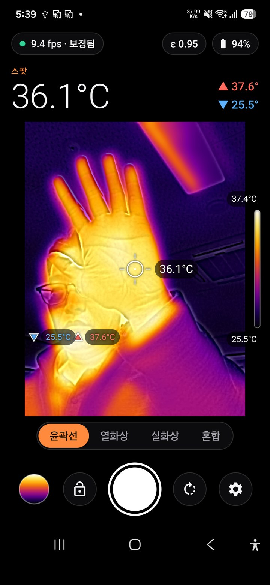

# FLIR ONE Viewer (Android)

**FLIR ONE 열화상 카메라를 안드로이드폰에서 실시간으로 보는 비공식 오픈 소스 앱**입니다.
FLIR 공식 앱이나 FLIR SDK 없이, USB 프로토콜을 **순수 Java**로 직접 구현했습니다.

가장 큰 특징은 **아이폰용(Lightning 8핀) FLIR ONE 도 안드로이드폰에서 쓸 수 있다**는 점입니다.
아이폰용 카메라는 연결된 기기가 아이폰인지 확인하는 Apple iAP2 연결 절차를 거칩니다.
FLIR 공식 안드로이드 앱에는 이 절차가 없어서, 아이폰용 카메라를 안드로이드폰에 꽂아도 5초마다 재부팅만 반복합니다.
이 앱은 iAP2 의 호스트(아이폰) 역할을 대신 수행해서 영상을 받아 옵니다.

<p align="center">
  
  <br>
  <sub>윤곽선(MSX) 모드 실행 화면 — 아이폰용 FLIR ONE + Galaxy SM-S938N</sub>
</p>

> English summary: An unofficial, open-source Android viewer for FLIR ONE thermal cameras, written in plain Java
> without the FLIR SDK. It also works with the **iPhone (Lightning) FLIR ONE** on Android: the app implements
> the Apple iAP2 host handshake that the camera expects, then streams thermal + visual frames over USB.
> Per-camera radiometric calibration is downloaded from the camera; the app adds Lepton-spotmeter drift
> correction, MSX-style edge overlay, visual-guided upscaling and temporal denoising. UI: English / Korean.

---

## 주요 기능

| 기능 | 설명 |
|---|---|
| 실시간 열화상 | 약 9fps, 팔레트 6종 (Iron, Rainbow, White hot, Black hot, Arctic, Lava) |
| 온도 측정 | 화면을 터치한 지점의 스팟 온도, 최고·최저 온도 위치 마커, 컬러바와 온도 범위 |
| 카메라별 온도 보정 | 카메라에서 보정 파일(`calib.rsc`)을 받아 고유 상수를 적용하고, 센서 자체 측정값으로 매 프레임 드리프트를 보정 |
| 윤곽선(MSX) | 실화상의 윤곽선을 열화상 위에 겹쳐서, 저해상도 열화상에서도 사물을 알아보기 쉽게 표시 (FLIR MSX 방식) |
| 화질 향상 | ① 시간축 노이즈 제거, ② 실화상 기반 업스케일(가이드 필터, 80×60 → 480×360) |
| 화면 모드 | 윤곽선(기본) / 열화상 / 실화상 / 혼합. 실화상과 열화상은 카메라의 정합 값으로 위치를 맞춤 |
| 셔터 보정(FFC) 처리 | 1~3분마다 일어나는 셔터 보정 동안 화면을 멈춰 두어 번쩍임을 없앰 |
| 프레임 무결성 검사 | 각 행의 Lepton CRC 를 검사해 손상된 프레임을 버림 |
| 사진 저장 | 영상 부분만 잘라 JPEG 로 저장 (`Pictures/FlirOneViewer`, 갤러리에 표시) |
| 화면 회전 | 4방향(거꾸로 세로 포함) 자동 회전. 카메라가 폰에 고정되어 있으므로 화면 회전 각도만큼 영상을 반대로 보정 |
| 화면 디자인 | 카메라 앱 형태의 전체 화면 어두운 UI, 반투명 칩·모드 바·셔터 버튼, 촬영 플래시·진동, 설정 기억 |
| 기타 | 범위 고정/자동, 수동 90° 회전, 방사율 조정, 배터리 잔량 표시, 영어·한국어 UI |

카메라 전용 데이터(보정값 등)는 연결할 때마다 카메라에서 자동으로 받아오며, 사용자가 따로 설정할 것은 없습니다.

## 지원 기기

| 기기 | 상태 |
|---|---|
| **아이폰용 FLIR ONE (Lightning)** — 모델 435-0004-01, 펌웨어 1.0.34, 열화상 80×60 | ✅ 실기기 검증 (Samsung Galaxy SM-S938N, Android 16) |
| 안드로이드용 FLIR ONE (USB-C / micro-USB, Gen3 / Pro / Pro LT) | ⚠️ 이론상 지원. 공식 앱과 같은 USB 절차를 구현했지만 실기기로는 시험하지 않음 |
| FLIR ONE Edge / Edge Pro (Wi-Fi·Bluetooth) | ❌ 지원 안 함 |

- 폰 요구 사항: Android 10 (API 29) 이상, USB 호스트(OTG) 지원
- USB VID/PID: `0x09CB` / `0x1996` (아이폰용과 안드로이드용이 같음)

### 아이폰용 카메라 연결 젠더

아이폰용 FLIR ONE 은 **Lightning(8핀) 암 → USB-C 수 변환 젠더**로 안드로이드폰에 연결합니다.
아래 알리익스프레스 상품으로 동작을 확인했습니다.

- 👉 [알리익스프레스 Lightning → USB-C 변환 젠더](https://ko.aliexpress.com/item/1005008035704308.html)

> 데이터 전송을 지원하지 않는 충전 전용 젠더는 동작하지 않습니다.
> 카메라는 폰에서 충전되지 않으므로, 카메라 자체 충전 포트로 따로 충전하세요.

## 사용법

1. 카메라 전원을 켜고 폰에 연결합니다(아이폰용은 위 젠더 사용).
2. 앱이 자동으로 실행되며 USB 권한을 묻습니다. "허용"을 누릅니다.
   - 공식 FLIR ONE 앱도 설치되어 있으면 어느 앱으로 열지 묻습니다. **FLIR ONE Viewer** 를 고르세요.
3. 연결 직후 카메라와 iAP2 연결 및 보정 파일 수신을 자동으로 처리하며, 1~2초 안에 영상이 나옵니다.

화면 구성: 위쪽에 상태 칩과 측정값(스팟·최고·최저), 가운데에 영상, 아래쪽에 모드 바와 컨트롤이 있습니다.

| 위치 / 조작 | 동작 |
|---|---|
| 상단 상태 칩 | 연결 상태(초록=영상 수신, 노랑=연결 중·셔터 보정, 회색=미연결), fps, 보정 상태. **길게 누르면** 카메라 상태 JSON |
| 상단 ε 칩 | 측정 대상 방사율 ε 변경 (기본 0.95, 사람 피부 ≈ 0.98) |
| 상단 배터리 칩 | 카메라 배터리 잔량 (15% 이하면 빨간색) |
| 큰 숫자 / ▲ ▼ | 스팟 온도 / 화면 내 최고·최저 온도 |
| 화면 터치 | 그 지점으로 스팟(십자) 이동. 십자 옆에도 온도 표시 |
| 모드 바 | 윤곽선 / 열화상 / 실화상 / 혼합 |
| 팔레트 버튼 (왼쪽 원) | 팔레트 미리보기 패널 열기 → 원하는 팔레트 선택 |
| 자물쇠 버튼 | 컬러 범위 고정 / 자동 (고정하면 주황색) |
| 가운데 큰 원 | 사진 저장 (영상 부분만, `Pictures/FlirOneViewer`) |
| 회전 버튼 | 영상 90° 회전 (기억됨) |
| 톱니바퀴 | 화질·윤곽선 설정: 노이즈 제거, 화질 향상, 렌즈 방향(화면 쪽/뒷면), 윤곽 강도(0~300%), 정합 거리(0.1~5 m, 시차 보정) |

## 빌드

- Android Studio 에서 이 폴더를 엽니다. `local.properties`(SDK 경로)는 Android Studio 가 자동으로 만듭니다.
- 사용 버전: Gradle 9.8.1 (wrapper 포함), AGP 9.3.1, compileSdk/targetSdk 36, minSdk 29, Java 17. 외부 라이브러리는 쓰지 않습니다.
- 디버그 빌드: `gradlew assembleDebug`, 단위 테스트: `gradlew testDebugUnitTest` (18개)
- 릴리즈 빌드: `gradlew assembleRelease` → `app/build/outputs/apk/release/app-release.apk`
  - 서명하려면 프로젝트 루트에 `keystore.properties` 를 만듭니다. 이 파일과 키 파일은 저장소에 포함되지 않습니다.
    ```properties
    storeFile=keystore/release.jks
    storePassword=...
    keyAlias=...
    keyPassword=...
    ```
  - `keystore.properties` 가 없으면 서명하지 않은 APK(`app-release-unsigned.apk`)가 만들어집니다.
  - 키 만들기 예: `keytool -genkeypair -keystore keystore/release.jks -storetype PKCS12 -alias <별칭> -keyalg RSA -keysize 4096 -validity 10000`
- 언어 리소스: 영어(기본, `values/`), 한국어(`values-ko/`)

## 코드 구성

| 파일 | 역할 |
|---|---|
| `usb/FlirOneCamera.java` | USB 인터페이스 claim, 엔드포인트 매핑, 채널 on/off, `UsbRequest` 폴링, iAP2 판별, 보정 파일 요청 |
| `usb/Iap2Host.java` | Apple iAP2 호스트 측 최소 구현 (Detect, 링크 동기화, 인증, 식별, EA 세션) |
| `protocol/FrameAssembler.java` | USB 조각을 `0xBEEF` 프레임(열화상 + JPEG + 상태 JSON)으로 조립, 헤더 CRC32 검증 |
| `protocol/ThermalDecoder.java` | Lepton 행 레이아웃을 raw 영상으로 변환, 텔레메트리 행 해석, 행 CRC 검사 |
| `protocol/CameraFilesReceiver.java`, `protocol/CalibRsc.java` | 카메라의 `CameraFiles.zip` 수신·해제, `calib.rsc` 에서 보정·정합 상수 추출 |
| `thermal/TemperatureConverter.java` | FLIR extRBF 모델로 raw → °C, Lepton 스팟미터 기반 드리프트 보정, 방사율 반영 |
| `thermal/Fusion.java`, `thermal/Msx.java` | 실화상 정합(시야 배율·시차), MSX 윤곽선 합성 |
| `thermal/Enhance.java`, `thermal/TemporalDenoiser.java` | 가이드 필터 업스케일, 움직임 적응형 노이즈 제거 |
| `thermal/Palette.java` | 컬러 팔레트 |
| `ui/FrameRenderer.java`, `ui/ThermalView.java` | 표시용 비트맵 생성, 마커·컬러바·십자 그리기, 회전, 사진 캡처 |
| `ui/PaletteSwatchView.java` | 팔레트 그라디언트 미리보기 (팔레트 버튼과 선택 패널) |
| `MainActivity.java` | 권한, 장치 연결·분리, FFC 처리, 설정, 저장 |

---

## 동작 원리 (분석 결과)

FLIR ONE 공식 앱 `com.flir.flirone` 5.3.13 을 정적 분석하고(JADX 디컴파일, 네이티브 라이브러리 역어셈블),
실기기에서 USB 통신을 관찰해 프로토콜을 확인했습니다. FLIR 의 코드나 바이너리는 이 저장소에 포함되어 있지 않습니다.

### USB 연결 (공식 앱 `UsbDriver` 분석)
- 엔드포인트: CONFIG IN 1 / OUT 2, FILEIO IN 3 / OUT 4, FRAME IN 5
- 채널 on/off: 표준 SET_INTERFACE. FILE_IO 는 인터페이스 1, FRAME 은 인터페이스 2.
  - 순서: FILE_IO 끄기 → FRAME 끄기 → FILE_IO 켜기 → 폴링 시작 → FRAME 켜기
- 인터페이스 1·2 의 엔드포인트는 alt 1 에서만 나타납니다.
  → `UsbDeviceConnection.setInterface()` 로 전환해야 커널이 엔드포인트를 활성화합니다.
  (공식 앱처럼 제어 전송으로 직접 보내면 Android 에서는 `UsbRequest.queue` 가 실패)

### 프레임 형식 (네이티브 `RBProtocol_framePacketParser_writeFrameToOutputBuffer` 역어셈블)
```
u32 0xBEEF | u32 seq | u32 total | u32 thermalSize | u32 jpegSize | u32 statusSize | u32 CRC32(헤더 앞 24바이트)
→ 열화상 raw | 실화상 JPEG | 상태 JSON
```
- 열화상(이 카메라): 82워드 × 63행. 각 행 = Lepton VoSPI 패킷(행 번호, CRC16-CCITT, 80픽셀)이고, 행 0~59 는 영상, 60~62 는 텔레메트리입니다.
- 상태 JSON 예: `{"shutterState":"ON","shutterTemperature":307.9,"ffcState":"FFC_VALID_RAD", ...}`

### 아이폰용 카메라: iAP2 연결 절차 (실기기 관찰)
1. 카메라가 EP 0x81 로 iAP2 Detect `FF 55 02 00 EE 10` 을 1초마다 보냅니다. 응답이 없으면 약 5초 뒤 재부팅합니다.
2. 앱이 같은 바이트로 응답 → 카메라 링크 SYN(세션 1=Control, 2=External Accessory) → 앱 SYN+ACK
3. 인증서 요청(0xAA00) → 카메라 인증서 수신(0xAA01) → 인증 성공 통보(0xAA05)
   - 검증하는 쪽은 호스트이므로, 앱은 인증서를 받고 수락만 합니다.
4. 식별 시작(0x1D00) → 카메라 식별 정보(0x1D01) → 수락(0x1D02)
   - 식별 정보: 모델명, 펌웨어, EA 프로토콜 `com.flir.rosebud.config` / `fileio` / `frame`
5. `com.flir.rosebud.config` EA 세션 시작(0xEA00) → FRAME(EP 0x85)으로 영상 수신 시작
   - 세 세션을 한꺼번에 열면 카메라가 재부팅합니다. 그래서 config 하나만 엽니다.
- 앱이 재시작되어 이전 링크가 남아 있으면 iAP2 링크 RST 를 보내 다시 동기화합니다.

### 온도 보정
1. **보정 파일:** config 채널로 `openFile("CameraFiles.zip")` → `readFile` → FILEIO 로 ZIP 수신 → `closeFile`
   - config 패킷 헤더: `u32 0x1CC | u32 1 | u32 길이 | u32 CRC32(헤더 앞 12바이트)`
   - ZIP 에 절대 경로 항목이 있어 Android 14+ `ZipInputStream` 이 거부하므로 직접 파싱합니다.
2. **상수:** `calib.rsc` 에서 `fixedLensID` 에 맞는 `.calib.extRBF.ds120C_*_<lens>.{R,B,F,J0,J1}` 를 선택합니다.
   - 모델: `S = 4·raw`, `S(T) = J0 + J1·R / (e^(B/T) − F)`
3. **드리프트 보정:** 센서 온도에 따라 raw 값이 흐르므로, 텔레메트리의 Lepton 라디오메트릭 스팟미터(중앙 2×2 영역의 온도)를 기준으로 매 프레임 신호 오프셋을 추정해 전체에 적용합니다.
   - 결과: 보정 전 손 42°C·벽 31°C → 보정 후 얼굴 최고 37°C 안팎·실내 배경 21°C
4. **방사율:** `S_obj = (S − (1−ε)·S(T_refl)) / ε`

### 실화상 정합과 윤곽선(MSX)
- `calib.rsc` 의 `.calib.visual.fusion.<lens>.*` 를 씁니다(이 카메라: magnQuote 1.2516, 시차 `C0 + C1/거리`).
  - 실화상 시야가 열화상보다 1.25배 넓으므로, 실화상에서 열화상 시야에 해당하는 영역만 잘라냅니다.
- 윤곽선: 정합된 실화상 휘도의 디테일 `d = (Y − boxBlur(Y, 4)) × 2.5 × 강도` 를 `120·tanh(d/120)` 으로 부드럽게 제한해 열화상 컬러에 더합니다.
  - 어둡고 대비가 낮은 곳의 약한 윤곽도 잘 보이고, 강한 윤곽은 하얗게 날아가지 않습니다.

### 화질 향상
- **노이즈 제거:** 픽셀별 재귀 평균입니다. 작은 변화(≤4 카운트, 센서 노이즈)는 강하게 평균하고, 큰 변화(≥16)는 즉시 따라갑니다.
- **업스케일:** 열화상을 6배 쌍선형 확대한 뒤, 정합된 실화상 휘도를 가이드로 가이드 필터(He et al.)를 적용합니다.
  - 열 경계가 실화상 경계에 맞춰 선명해지고, 온도 차이가 없는 무늬는 옮겨지지 않습니다.
- 온도 측정값(스팟·최고·최저)은 항상 **원본 센서 값**으로 계산합니다. 화질 향상은 표시에만 쓰입니다.

## 한계와 주의 사항

- 이 앱은 Teledyne FLIR 와 관계없는 **비공식** 앱입니다. FLIR, FLIR ONE 은 Teledyne FLIR LLC 의 상표입니다.
- 온도는 Lepton 센서의 라디오메트릭 정확도(대략 ±5°C 또는 ±5%) 수준입니다. **의료·안전·정밀 측정 용도로 쓰지 마세요.**
- 화질 향상은 보기 좋게 다듬는 처리이며, 실제 측정 해상도(80×60)가 높아지지는 않습니다. 어두운 곳에서는 실화상 기반 기능의 효과가 줄어듭니다.
- 고온 범위(ds400C) 전환, 카메라 펌웨어 업데이트, 카메라 저장 파일 가져오기는 지원하지 않습니다.
